# 4macOS

## Screenshots

| | |
| --- | --- |
| 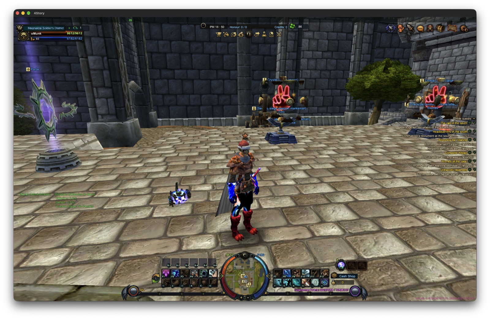<br>**Magnaktia Soldier's District.** The town hub in the native macOS window: portal, NPCs, the quest list, minimap, skill bars and the pink build label in the bottom right corner. | 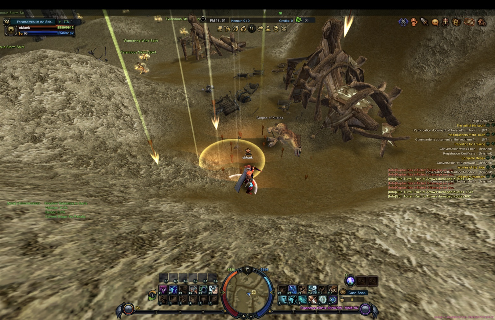<br>**Encampment of the Spirit.** A volley of arrows from the gun turret's Rain of Arrows falls on a Kuptas, with the damage lines in the chat log. |
| 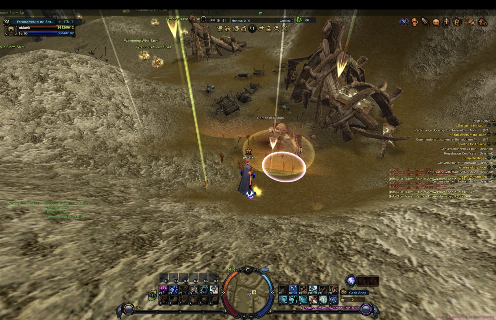<br>**Targeting an area skill.** The same fight a moment later, with a ground-target circle placed on the Kuptas while the arrows keep falling. | 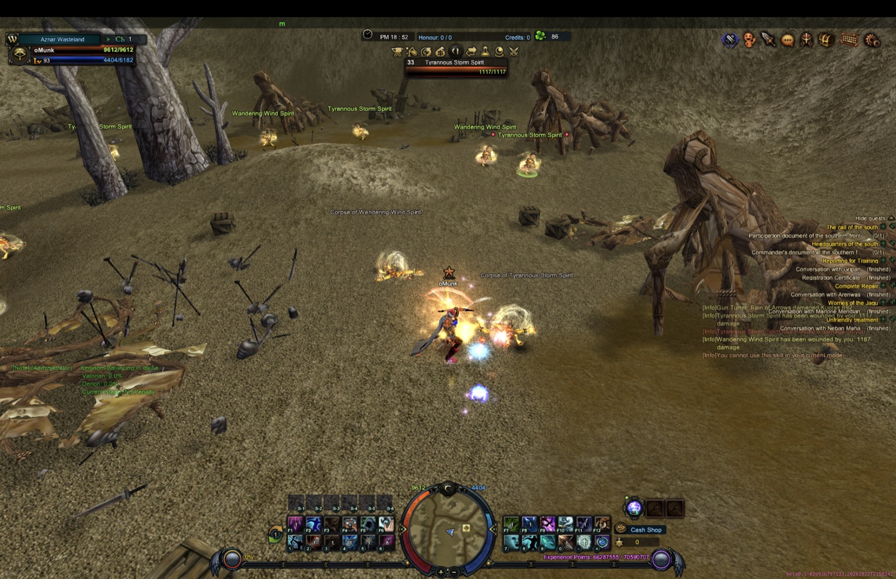<br>**Fighting spirits.** Skill effects against Tyrannous Storm Spirits and Wandering Wind Spirits in Aznar Wasteland, with the target's health bar and the combat log. |
| 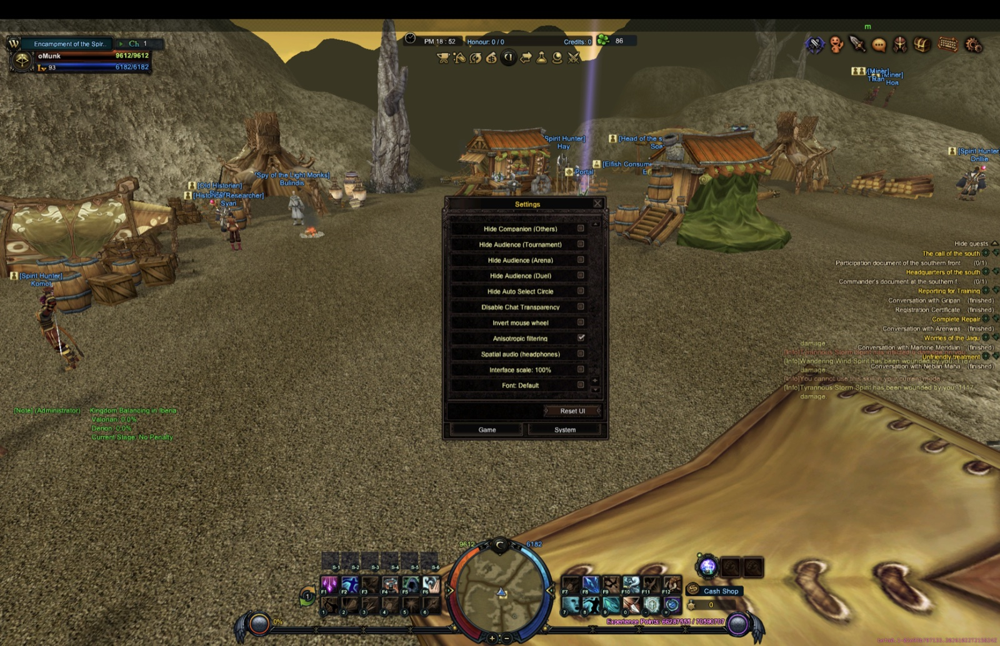<br>**Game settings.** The in-game settings window with the options added by the port: anisotropic filtering, spatial audio for headphones and the interface scale. | 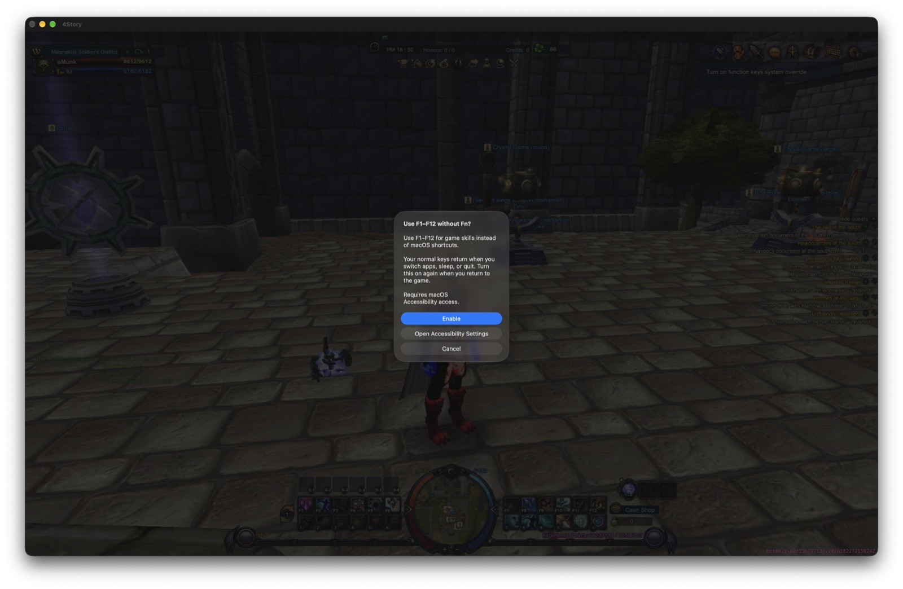<br>**F1–F12 without Fn.** The prompt that offers to use F1–F12 for game skills instead of macOS shortcuts. It needs macOS Accessibility access, and the normal keys return when you switch apps, sleep or quit. |

### Build and run

A fresh setup from a clean copy of the workspace, from the build to a first login. These are the terminal output of the launcher commands and the game client, captured on an Apple silicon Mac.

**1. Check the inputs.** `./4story.command doctor` checks that the game data, libraries and database seeds are present and that nothing links outside the folder. It installs nothing.

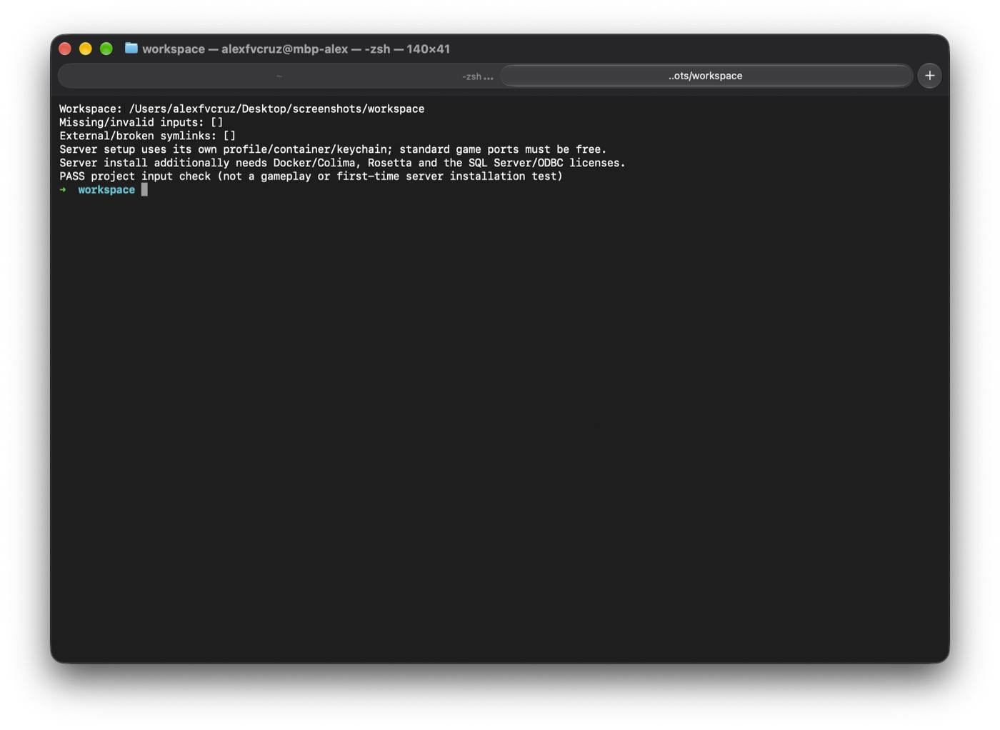

**2. Build.** `./4story.command build all --channel dev --version 0.1` compiles the client, the four game servers and the account tools, then signs the app bundle. The channel and version appear in the client's build label.

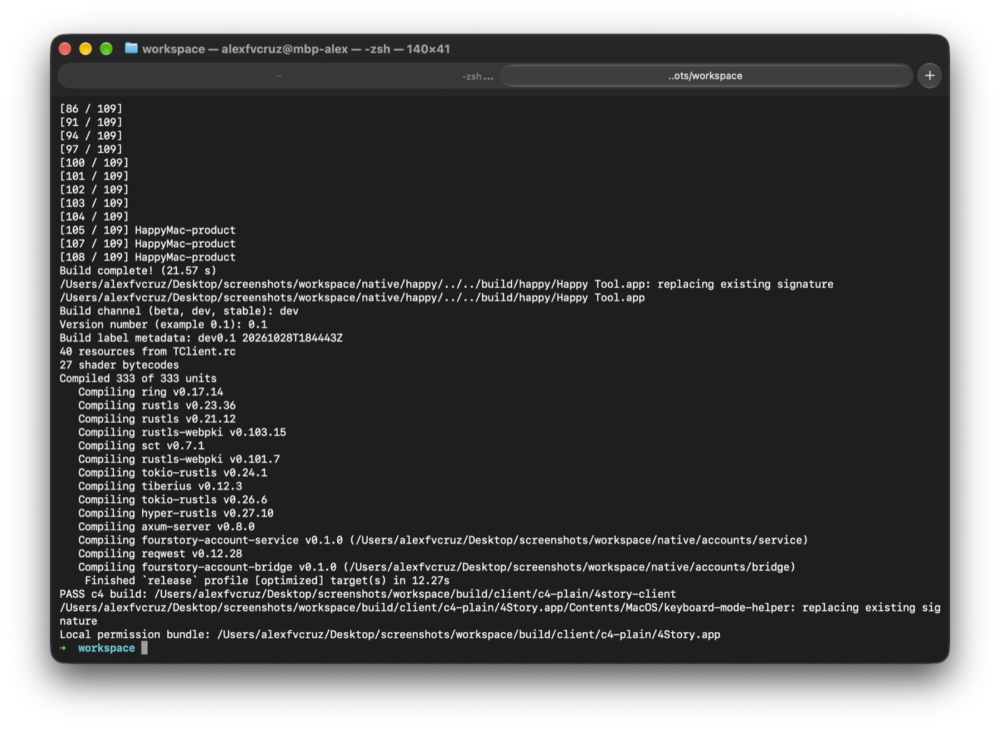

**3. Install the server.** `./4story.command server install` starts a Colima/Docker profile, accepts the SQL Server Express license on your answer, restores the clean databases and asks which address players connect to.

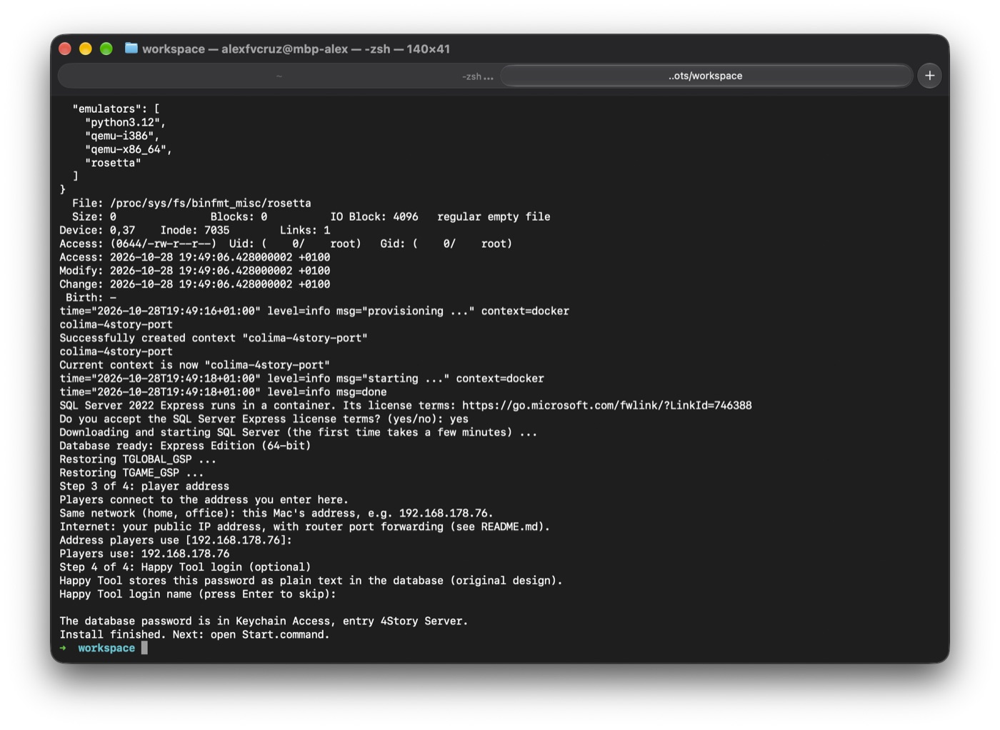

**4. Start the game servers.** `./4story.command server start` brings up the Control, Login, World and Map servers and waits until each one reports ready.

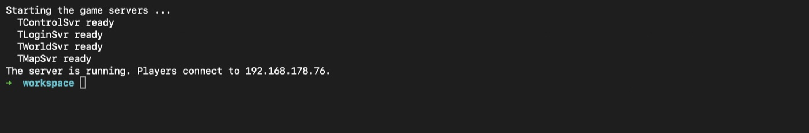

**5. Create an account.** `./4story.command server create-account NAME` asks for a password twice (it is not echoed) and adds the game account.

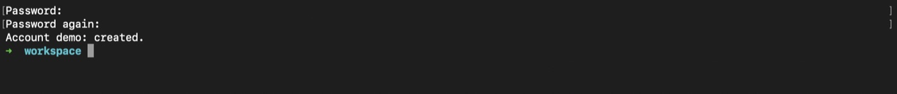

**6. Check the status.** `./4story.command server status` shows each game server, the database and the address players use.

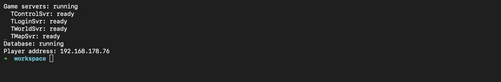

**7. Log in.** `./4story.command client` opens the native macOS client at the 4Story login screen, with the build label in the bottom right corner.

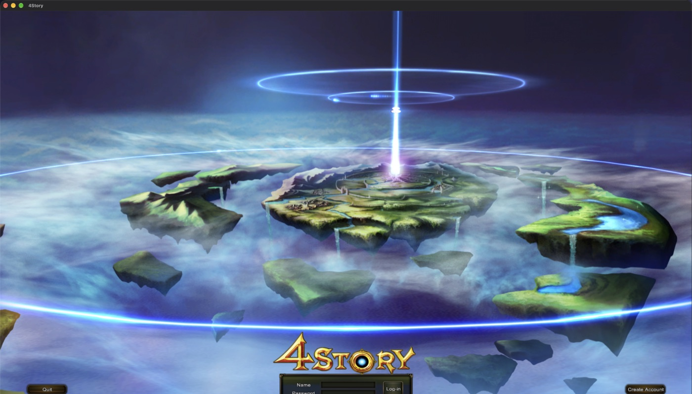

This folder carries the native client/server source, development tools, game
data, third-party runtime libraries, dependency sources, locked Rust crates,
build tools and clean database seeds.

- `source/`, `native/`, `tools/`: application source and development tools.
- `game/`: game data used by the native client.
- `deps/`: supplied libraries, headers, third-party sources, build tools and Rust crates.
- `server/database/`: clean initial database backups and integrity manifest.
- `build/`: generated programs and object files; recreated by building.
- `runtime/`: new local configuration, settings and logs; never share personal state.
- `tools/publication/INPUTS.md`: Game data

## What the macOS port adds

The original 4Story 5.0 C++ source is a Windows-only game (Direct3D 9, MFC, Win32, IOCP, SQL Server).
This port runs the original client and server code natively on Apple silicon.

### Server

- **Native game servers.** The original Control, Login, World and Map servers
  build and run as macOS ARM64 programs, over a Win32/ATL/ODBC compatibility
  layer. They load their full game state, register with each other and shut
  down cleanly.
- **Your own server in a few commands.** `server install / start / stop /
  status / create-account` sets up SQL Server in Colima/Docker from the clean
  database seeds. The database password goes in the macOS Keychain.
- **Live startup and status screens.** Startup shows each service's readiness
  and elapsed time. Status is a clickable terminal dashboard (green, amber,
  red) that refreshes in place. Stop shows the shutdown order.
- **Faster Map startup.** Cached quest reads cut Map startup from 63 s to 36 s.
- **Reliability fixes.** Sessions no longer get stuck after a mass logout. The
  socket layer is a native kqueue/epoll reactor instead of Windows IOCP.
- **Role control and a supervisor.** Control can stop and start single
  services. A process supervisor restarts crashed services with back-off.
- **Linux x86_64 server.** A first Linux run on a VPS was recorded. This current repository however doesn't contain what's necessary to build the Linux server files.
- **Safety fixes in the original source.** The Map server now rejects
  inventory slots beyond the bag size. A commented-out SMTP credential was
  removed from the Login source.

### Client

- **Native game client.** The original TClient (about 330 source files) builds
  for macOS. It uses SDL3 for windowing, DXVK (Direct3D 9 to Vulkan) and
  MoltenVK (Metal) for graphics, and Apple frameworks for audio and fonts. The
  game's data files load unchanged. It reaches the login screen, logs in,
  creates and deletes characters, enters the world, and covers movement,
  combat, loot, chat, inventory, quests and relogging.
- **Checked against Windows.** Rendering, texture sharpness, packets,
  character create/delete and saved database state were compared with the
  Windows client. They matched in the tested scenes and scripts.
- **64-bit fixes.** Pointer, ID and font-width bugs from the old 32-bit code
  were fixed so the client works as a 64-bit program.
- **Native audio.** Effects, music and the two audio-only DirectShow assets
  play through AVFoundation. An optional **Spatial audio (headphones)**
  setting in the game's options uses Apple's HRTF rendering.
- **Graphics options.** Anisotropic filtering, an adjustable terrain/decal
  depth offset, and a graphics diagnostics log.
- **Interface scaling and live font selection.** Both are in the game settings.
- **Fullscreen and display controls.** Fullscreen toggle, a reversible display
  preview, and an option to start fullscreen.
- **Window behaviour.** The game shades when unfocused and fades back in on
  return. Stale input is discarded and background camera polling is blocked.
- **F1–F12 without Fn.** An in-game keyboard button turns on standard function
  keys (needs Accessibility permission). It restores your original keyboard
  mode on exit, even after a crash.
- **Quest tracker** can be hidden and moved.
- **Fixes to the original client.** Each bag window is built from the bag's
  own template, the exit dialog spacing is even, and the tournament panel no
  longer flashes on world entry. Crashes in NPC
  greeting sounds, click handling and the MoltenVK command-list release were
  also fixed.
- **Build label.** A small pink label shows channel, version, executable ID
  and link time, so a stale build is easy to spot. The client refuses to run a
  stale build.
- **Crash reports.** A native crash reporter writes readable reports.
- **PS5 controller support, toward an iPad port (in progress).** Exploring
  whether the game can run on iPads, where a controller is the main input.
  DualSense detection and logging is merged. Movement, camera, targeting and
  zoom are built and in testing; skills, the touchpad and the iPad build itself
  are not started.

### Packaging and sharing

- **App and disk image.** Release build mode produces a signed **4Story (Beta)**
  app and DMG with a checker, a player README, a custom icon and a new intro
  logo. The "Araz" title in the game data was renamed.
- **Server release bundle.** Tools build a server package and a clean database.
- **One launcher.** `4story.command` is a menu and CLI for doctor, build,
  client, server, logs and profiling.

### Developer tools

- **Terminal asset renderer.** `assets list / show` previews any item,
  monster or NPC model from the game files.
- **Profiling.** Attach-only workflows for the Mac client and the servers,
  with symbol preparation.
- **Test-character tools.** Place characters, grant items and
  swap an item's template.
- **Load testing** with dummy clients.
- **Saved-state comparison.** Captures a character's database rows before and
  after a session and compares them.
- **Compatibility checks.** A Windows-view check proves the original source
  is unchanged, apart from listed comment-only edits and build-project fixes.
- **Issue workflow.** One folder, one branch and one worktree per bug
  (`4story.command issue`), with archiving once merged.
- **Research notes and tooling.** A Graphify code map, a reverse-engineering
  skill for this project, and written reports for each milestone.

## Build

Use an Apple silicon Mac with Apple developer tools, Python 3 and full Xcode for
Happy Tool. The project dependency libraries and Rust toolchain are supplied.
No download is needed for the normal client/accounts build.

The game uses the supplied MoltenVK 1.4.2 binary. The optional upstream source
snapshot is `deps/sources/MoltenVK-source.tar.gz`; its pinned external sources
are not populated. Rebuilding MoltenVK itself requires its `fetchDependencies`
step. Other historical probe/release tools retain their own prerequisites;
the commands below are the supported workflow for this workspace.

```sh
./4story.command doctor
./4story.command build all --channel dev --version 0.1
```

`Build.command` offers the same build and asks for channel/version when omitted.
To build only one target, replace `all` with `client`, `server`, `accounts` or `happy`.
Building does not start game servers or alter a database.

## Play

After building, open `Play.command` or the development app under
`build/client/c4-plain/4Story.app`. Both select this folder's `game/` and libraries.

```sh
./4story.command client --server SERVER_IP
```

The server owner supplies a game account. The default port is 4815. Loopback is
not a valid local game-login address for this server; use the Mac's LAN address.

## Run your own server

The server installer uses the supplied clean seeds. It does not need the original
developer's SQL backups, audit manifests, database password, or existing container.

```sh
./4story.command server install
./4story.command server start
./4story.command server create-account
./4story.command server status
./4story.command server stop
```

Install can install Homebrew prerequisites and asks for Microsoft licenses. It
needs internet for Homebrew packages, Docker/Colima and SQL Server; the image also needs
Rosetta. It uses profile `4story-port`, container `4story-port-sql`, SQL port 14334,
and Keychain entry `4Story Port Server`. Configuration and game logs stay under
`runtime/server/`; live SQL data stays in the `4story-port-data` Docker volume
inside that Colima profile.
The game listener ports are 3615, 4815, 3815, 5815 and 4700. Another server using
those ports must be stopped before this server can start; setup never stops it.

### Connect to the database

1. Open **Keychain Access** and search for **4Story Port Server**.
2. Double-click it and tick **Show password**.
3. Connect with user `sa` at `127.0.0.1`, port `14334`, to `TGLOBAL_GSP` and
   `TGAME_GSP`. This works only on the server Mac, while this workspace's server runs.

## Machine where I ran the server and client

16 inch M1 Max Macbook Pro
64GB RAM
24 GPU Cores
10 CPU Cores
